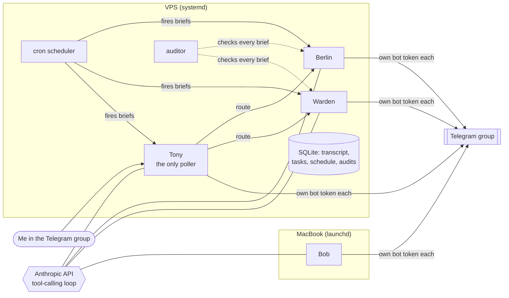
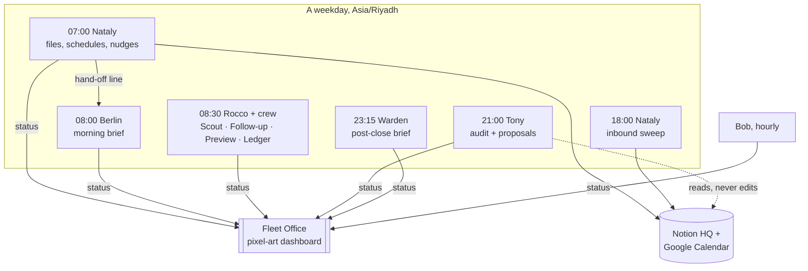

# Agent Fleet

[](https://github.com/Mosabhavi/agent-fleet/actions/workflows/tests.yml)


A small team of AI agents that runs my day-to-day: a COO who audits the others, a chief of
staff who writes the morning brief, an account monitor that is not allowed to trade, an
executive assistant who owns my calendar and Notion, a lead-generation agent with its own
sub-agent crew, and a butler who tidies my Mac and will never open the wrong folder.

Each agent has its own name, voice and Telegram account, so the group chat reads like a
team rather than one bot wearing six hats. More importantly, each one has **hard rules
that outrank its personality** — and the dangerous ones are enforced in code and tests,
not just asked for in a prompt.

| Agent | Role | Runs | Can it act on its own? |
|---|---|---|---|
| **Tony** | COO — routes work, owns the schedule, audits the fleet, proposes new jobs | daily | Schedules and dispatch only. Changes to the fleet need my approval. |
| **Berlin** | Chief of staff — morning brief | Sun–Thu 08:00 | Read-only. |
| **Warden** | Brokerage monitor — post-close brief | Mon–Fri 23:15 | **Never.** Drafts orders; every one needs a per-order confirmation. |
| **Nataly** | Executive assistant — Notion, Google Calendar, deadlines | 3× (daily, evening, weekly) | Files and schedules. Never deletes, never contacts anyone. |
| **Rocco** | Lead generation for my web-design side business, with 4 sub-agents | Sun–Thu | Max 5 emails a run, 3 touches per business, opt-outs are permanent. |
| **Bob** | File organizer on my Mac | hourly | Moves files. Never deletes, never enters a sealed folder. |

## Two generations

The fleet has been rebuilt once, and both versions are in this repo.

### Generation 1 — Telegram runtime (`fleet/`)

A dependency-light Python service (httpx, croniter, SQLite) that runs four bots in one
private Telegram group.



Design decisions worth calling out:

- **One poller, four voices.** Only Tony long-polls Telegram (privacy mode off, so he
  sees every message). The other bots are send-only. If every bot polled, every agent
  would answer the same message.
- **Routing:** an explicit mention or a reply goes straight to that agent; anything else
  goes through a one-word LLM classification, falling back to Tony on an unknown verdict.
- **The auditor.** After every scheduled brief, Tony checks it against that agent's
  standing rules and calls out a violation publicly, quoting the rule. A clean report gets
  no message — silence is the pass mark. Rules live in `fleet/config.py`, separate from
  the persona files, so rewriting a voice cannot silently drop a rule.
- **Owner-only controls.** Only my Telegram user ID can `/pause`, `/resume`, `/approve`
  or `/reject`. Strangers get told no.
- **Containment.** The systemd unit runs as a dedicated user with `ProtectSystem=strict`,
  `ProtectHome`, `NoNewPrivileges` and a single writable path.
- **Bob stays local** because the files are local, and posts through his own token.

### Generation 2 — scheduled Claude agents (`agents/`)

The cloud sandbox the newer agents run in cannot reach `api.telegram.org`, but it can
reach every data source they actually need through native connectors — Gmail, Google
Calendar, Notion, Todoist, Interactive Brokers, web search. So the agents moved onto
cron-triggered Claude runs and the hand-written API glue disappeared; the persona and
rules that used to be Python config became the prompt.



Every agent reports `working → step → done/error` to a small shared database behind a
pixel-art **Fleet Office** page where each agent has a desk, a 14-day heatmap and a
reliability score — so a run that "succeeded" but reported nothing shows up as an empty
desk, and Tony flags it.

The full specs, with personal data and workspace IDs replaced by placeholders, are in
[`agents/`](agents/).

## Guardrails, and where they are enforced

| Guardrail | Enforced in |
|---|---|
| Warden never submits, modifies or cancels an order; one confirmation per order, no batch approval | Prompt + `config.py` rules + auditor + test |
| Positions on the hold list are never proposed for exit | `FLEET_HOLD_LIST`, injected into Warden's rules + test |
| Every trade proposal states cash vs margin and the risk of total loss | Rules + auditor + test |
| Bob never enters a sealed folder, at any depth | `bob_local.py` + a test that plants a file inside one and checks it survives a full run |
| Bob never deletes; junk goes to a review folder | Code (no delete path exists) + test |
| Nobody fabricates another agent's output | Rules + auditor |
| Tony proposes fleet changes but cannot make them unattended | Prompt; changes need explicit approval in conversation |
| Rocco: ≤5 emails/run, ≤3 touches/business, opt-out is permanent across every channel | Prompt; sending is never delegated to sub-agents |
| No money figures or personal identifiers in any status line | Every agent's reporting block |

## Run generation 1

```bash
python3 -m venv .venv && .venv/bin/pip install -r requirements.txt
cp .env.example .env              # bot tokens, ANTHROPIC_API_KEY, group id
.venv/bin/python -m fleet whereami   # prints the group chat id and your user id
.venv/bin/python -m fleet doctor     # checks tokens, privacy mode, model access
.venv/bin/python -m fleet run
```

Bob on a Mac, looking before he leaps:

```bash
BOB_DRY_RUN=1 .venv/bin/python -m fleet bob
```

Production install on a VPS: `deploy/install.sh` + `deploy/fleet.service`. Bob under
launchd: `deploy/com.mosab.bob.plist`.

### Group commands

| Command | Does |
|---|---|
| `/status` | who is running, what fired last |
| `/schedule` | every agent's cron |
| `/run <agent>` | produce that agent's brief now |
| `/pause <agent>` · `/resume <agent>` | stop or restart scheduled runs (owner only) |
| `/tasks` | open and proposed work |
| `/approve <id>` · `/reject <id>` | decide on Tony's proposals (owner only) |
| `/audit` | recent audit verdicts |

## Tests

```bash
python3 tests/test_fleet.py      # routing, storage, cron, rules, Bob's file safety
python3 tests/test_runtime.py    # end-to-end with a fake Telegram and a fake model
```

Both run fully offline and in CI on Python 3.11–3.13.

## Layout

```
fleet/            generation 1 runtime
  personas/       the voice of each agent (markdown)
  config.py       agents, schedules, and the rules the auditor enforces
  runtime.py      polling, dispatch, scheduler, commands
  router.py       who should answer this message
  llm.py          model selection + tool-calling loop
  tools.py        web/news/search, memory, tasks, schedule control
  bob_local.py    the file organizer
agents/           generation 2 specs (sanitized)
deploy/           systemd, launchd, install script
tests/
```

## What's next

- Moving the agents' runs onto local models (Ollama / LM Studio on the Mac) to cut
  API cost for the routine passes.
- Live brokerage data for generation 1 via the IBKR Client Portal API.
